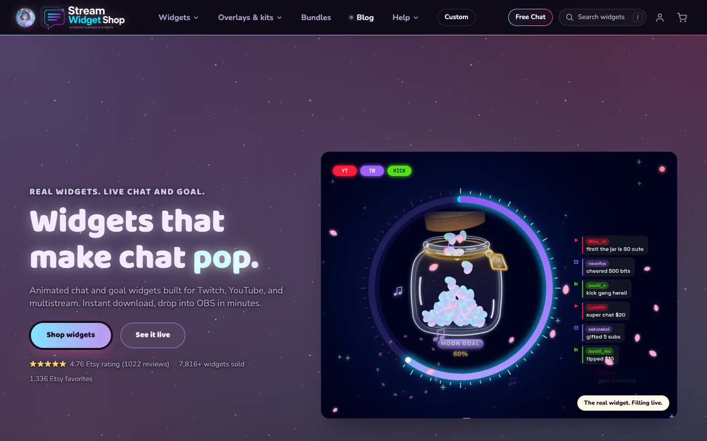

# Stream Widget Shop storefront

The headless Shopify storefront behind **[streamwidgetshop.com](https://streamwidgetshop.com)**, a shop for animated chat, goal and alert widgets that streamers drop into OBS for Twitch, YouTube and Kick.

[](https://streamwidgetshop.com)

> This is a read-only showcase copy of the production code. See [CONTRIBUTING.md](CONTRIBUTING.md) and [LICENSE](LICENSE).

## Features

- **Product pages built to sell a digital download**: live widget video, platform compatibility badges, Etsy rating summary, generated answer blocks and FAQ structured data, related widgets, and a sticky mobile add to cart.
- **Build your own bundle**: pick 3, 6 or 9 widgets for a tiered discount, with quick view and cart notes.
- **Free chat widget signup**: Cloudflare Turnstile, server-side throttling, one-time confirm links and a signed widget link.
- **Digital delivery in the customer account**: per-order download buttons backed by a separate downloads service with signed, short-lived file URLs.
- **Server-side conversion tracking**: Shopify's `orders/create` webhook fans each purchase out to GA4, X and Meta in parallel, with first-party click id capture, a first-party GA4 client and session id, and a same-origin event relay for visitors whose browser pixels are blocked. See [docs/conversion-tracking.md](docs/conversion-tracking.md).
- **Sales channel feeds**: product feeds at `/feed.xml`, `/feed.csv` (X) and `/feed.pinterest.csv`. See [docs/product-feeds.md](docs/product-feeds.md).
- **Search and AI discoverability**: sitemap with real `lastmod` dates, `robots.txt`, `llms.txt`, Product, Video and FAQ JSON-LD, dedicated video watch pages, and WebMCP agent tools.
- **Edge caching on Oxygen**: full-page caching for public pages, with personalised parts loaded after hydration. See [docs/edge-cache.md](docs/edge-cache.md).
- **"We're live" banner**: switched by one shop metafield, and only shown while the Twitch channel is verified live. See [docs/LIVE-BANNER.md](docs/LIVE-BANNER.md).
- **Self-checking**: `verify:*` and `audit:*` scripts for tracking, feeds, SEO fields, structured data, sitemap, share cards, policy claims and more, most with a `:self-test` mode.

## Tech stack

| Layer | What |
|---|---|
| Framework | [Shopify Hydrogen](https://shopify.dev/docs/storefronts/headless/hydrogen) 2026.4 on [React Router](https://reactrouter.com/) 7 (framework mode) |
| UI | React 18, Tailwind CSS 4, hand-written CSS in `app/styles/` |
| Data | Shopify Storefront API and Customer Account API (GraphQL, typed with Hydrogen codegen) |
| Build | Vite 8, Shopify CLI |
| Hosting | Shopify Oxygen |
| Media | Images and video served from the Shopify CDN |
| Quality | ESLint, Prettier (`@shopify/prettier-config`), `node:test` unit tests, script-based audits |
| Runtime | Node `^22 \|\| ^24` |

## Local setup

```sh
git clone https://github.com/skeletonking1984/sws-storefront-public.git
cd sws-storefront-public
npm ci
cp .env.example .env   # then fill in your own values
npm run dev
```

You need a Shopify store with the Hydrogen sales channel (or a headless storefront) to provide the Storefront API values.

### Environment variables

`.env.example` lists every variable the app reads, with empty values.

| Variable | Needed | Purpose |
|---|---|---|
| `SESSION_SECRET` | Required | Signs the session cookie |
| `PUBLIC_STORE_DOMAIN` | Required | Your `*.myshopify.com` domain |
| `PUBLIC_STOREFRONT_API_TOKEN` | Required | Storefront API public token |
| `PUBLIC_STOREFRONT_ID` | Recommended | Storefront id for Shopify analytics |
| `PUBLIC_CHECKOUT_DOMAIN` | Recommended | Checkout domain |
| `PRIVATE_ADMIN_API_TOKEN` | Recommended | Admin API token (newsletter list, server-side catalog reads) |

Everything else is optional: each integration does nothing until its own keys are set. Notifications go to `NOTIFY_EMAIL` (falls back to the public support address). `app/lib/configRegistry.js` documents every variable and what silently stops working without it.

### Scripts

| Command | What it does |
|---|---|
| `npm run dev` | Local dev server with GraphQL codegen |
| `npm run build` | Production build (stamps the commit into the build first) |
| `npm run preview` | Build and serve the production bundle locally |
| `npm run lint` | ESLint over the repo |
| `npm run codegen` | Regenerate GraphQL and React Router types |
| `npm run verify:all` | Run every check and print a summary. Many checks read the live site |

Unit tests run with `node --test $(find app -name '*.test.mjs')`.

## Project structure

```
app/
  routes/        Pages, resource routes (feeds, sitemap, llms.txt, APIs) and the orders webhook
  components/    UI components
  lib/           Server and shared logic: SEO, structured data, bundles, conversions, analytics, edge cache
  graphql/       Customer Account API queries
  data/          Build-time JSON (rating aggregates, rankings, delivery facts, video metadata)
  styles/        Site CSS
  assets/        Self-hosted fonts and favicon (images and video load from the Shopify CDN, see lib/cdnAssets.js)
data/            Product handle rename map used for redirects
docs/            Architecture notes and screenshots
scripts/         Verification and audit scripts
public/          Static files served as-is
server.js        Oxygen fetch handler
```

## Not included

This copy leaves out internal operations material: the launch log, QA artifacts, sales and review data, and the scripts that need private Etsy or Shopify Admin credentials to regenerate the JSON in `app/data/`. Review text and sales figures are stripped from that JSON, so product pages here show rating totals without written reviews.

## Links

- Live store: https://streamwidgetshop.com
- Security: [SECURITY.md](SECURITY.md)
- License: all rights reserved, see [LICENSE](LICENSE). Fonts are SIL OFL 1.1, see [app/assets/fonts/OFL.txt](app/assets/fonts/OFL.txt).
